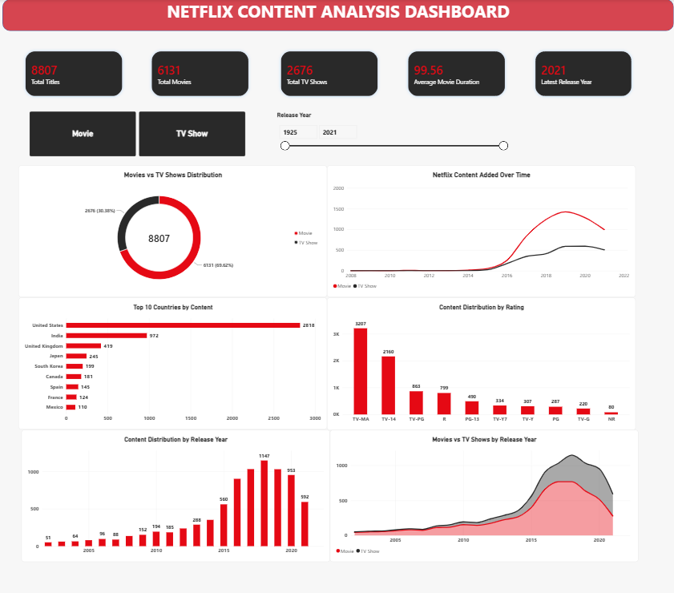

# Netflix Power BI Analysis

This folder contains the interactive Power BI dashboard developed for the Netflix Content Analysis project.

## Dashboard Features

- 5 KPI cards: Total Titles, Total Movies, Total TV Shows, Average Movie Duration, and Latest Release Year
- 6 analytical charts
- Interactive Content Type and Release Year slicers
- Netflix-inspired red, charcoal, and white design
- Dynamic KPI calculations using DAX

## Dataset

8,807 Netflix titles, including 6,131 movies and 2,676 TV shows.

## Tools Used

Microsoft Power BI Desktop, Power Query, and DAX.

## Dashboard File

`Netflix_Content_Analysis_Dashboard.pbix`

## Dashboard Preview

